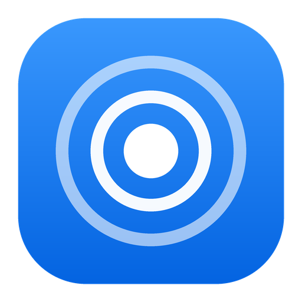
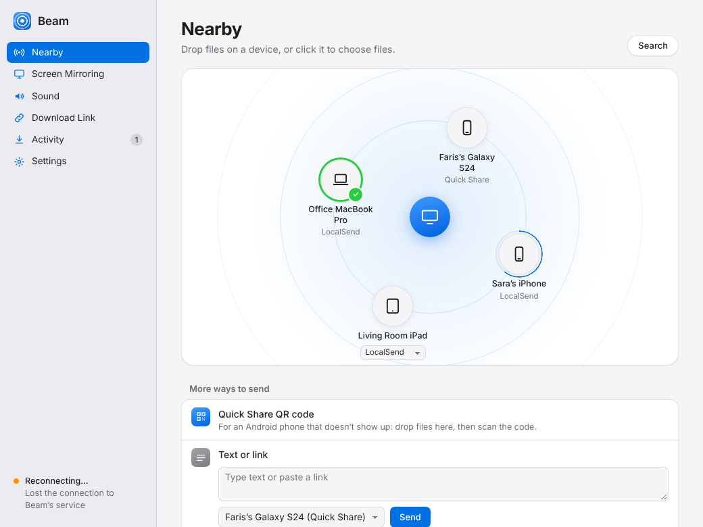
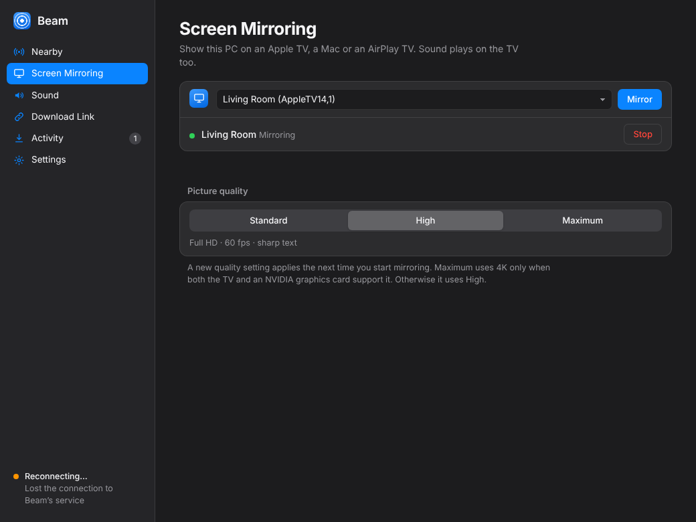

<p align="center"></p>

<h1 align="center">Beam</h1>

<p align="center">Send files between your Windows PC and any phone nearby, and mirror your screen to an Apple TV in sharp, high resolution.</p>

<p align="center">
  <a href="../../releases/latest"><b>Download for Windows</b></a> ·
  <a href="#picture-quality">Picture quality</a> ·
  <a href="#credits">Credits</a>
</p>

<p align="center"></p>

Beam is a fork of [MultiDrop](https://github.com/digitaldanis/multidrop). It does
everything MultiDrop does on Windows, with two additions:

1. **A redesigned app.** A calm, Apple-style window with a sidebar, grouped
   settings and light and dark mode. Nearby devices appear around your PC on
   a radar; drop files on one, and a ring fills as they send. Incoming
   requests slide in as a sheet you can't miss.
2. **High-resolution AirPlay mirroring.** MultiDrop mirrors with its engine's
   defaults: H.264 at the TV's nominal size (720p when the TV doesn't describe
   its screen), about 4 Mbps and 30 fps. Beam mirrors at Full HD, 60 fps and
   about five times the bitrate by default, and up to 4K on an Apple TV 4K.

## What it does

- **Receive from phones**: Android and Samsung send with Quick Share from the
  share menu; iPhones use the free LocalSend app.
- **Send to phones and PCs**: drop files on a device, or right-click files in
  Explorer → Send to → Beam. Text and links too.
- **Download link**: any phone on your Wi-Fi scans a code and downloads in the
  browser, with a PIN.
- **Screen Mirroring**: show your PC on an Apple TV, a Mac or an AirPlay TV,
  with sound.
- **Sound**: play your PC's sound on HomePod, Sonos and other AirPlay speakers.

## Install

Download `Beam-Setup.exe` from the [latest release](../../releases/latest) and
run it. It installs for your user only, with no admin rights needed. When
Windows asks once whether phones on your local network may connect, choose
**Yes**. Nothing from the internet can reach your PC.

`Beam.exe` is a portable version without screen mirroring.

If MultiDrop is installed, quit it first. Both use the same network ports.

## Picture quality



| Setting | Resolution | Frame rate | Bitrate at 1080p | Use it when |
|---|---|---|---|---|
| Standard | TV's nominal size; 720p if the TV doesn't say | 30 fps | about 4 Mbps | Wi-Fi is weak or the receiver is old |
| **High** (default) | at least 1920×1080 when the TV can decode it | 60 fps | about 21 Mbps | almost always |
| Maximum | up to 3840×2160 (HEVC) on an Apple TV 4K | 60 fps | up to 40 Mbps at 4K | Apple TV 4K plus an NVIDIA graphics card |

Maximum only uses 4K after Beam checks that your graphics card can encode 4K
HEVC fast enough. If it can't, or the TV doesn't support HEVC mirroring,
Maximum quietly falls back to High. A new setting applies the next time you
start mirroring.

How it works: Beam bundles the [doubletake](https://github.com/omarroth/doubletake)
mirroring engine with a small patch,
[`beam-quality.patch`](packaging/windows/doubletake/beam-quality.patch), that
adds these presets. It also enables doubletake's own 4K HEVC path, which
upstream ships switched off.

## Building

GitHub Actions builds everything on every push: tests on Linux and Windows,
the mirroring engine with both patches, `Beam.exe` (PyInstaller),
`Beam-Setup.exe` (Inno Setup) and an install/uninstall check. To publish a
release, bump `version` in `pyproject.toml`: the next push to `main` releases it. See [.github/workflows/build.yml](.github/workflows/build.yml).

To run from source on Windows:

```
pip install -e ".[windows,test]"
python -m multidrop.windows
pytest -q
```

The Python package keeps MultiDrop's internal name, `multidrop`, so upstream
changes stay easy to merge.

## Credits

Beam is free software under the [GPL-3.0](LICENSE). Almost all of the
networking and Windows code comes from
[MultiDrop](https://github.com/digitaldanis/multidrop) by digitaldanis. AirPlay
mirroring comes from [doubletake](https://github.com/omarroth/doubletake)
(LGPL-3.0). See [THIRD_PARTY_NOTICES.md](THIRD_PARTY_NOTICES.md) for every
component.
